# ⚖️ Desglose de la Ecuación Contable Fundamental

Este apunte sintetiza la composición interna de los tres elementos de la ecuación patrimonial: cómo se dividen los recursos de la empresa (**Activos**) y cómo se clasifican sus fuentes de financiamiento (**Obligaciones: Pasivo y Patrimonio**).

---

## 📊 1. Diagrama de Estructura (Mermaid)

```mermaid
flowchart TD
    classDef main fill:#1e293b,stroke:#8b5cf6,stroke-width:2px,color:#ffffff,font-weight:bold;
    classDef cat fill:#0f172a,stroke:#3b82f6,stroke-width:1.5px,color:#60a5fa,font-weight:bold;
    classDef oblig fill:#0f172a,stroke:#f43f5e,stroke-width:1.5px,color:#fb7185,font-weight:bold;
    classDef item fill:#1e293b,stroke:#475569,stroke-width:1px,color:#e2e8f0;

    EQ["⚖️ ACTIVO = PASIVO + PATRIMONIO<br/><i>(Ecuación Contable Fundamental)</i>"]:::main

    subgraph ESTRUCTURA_ACTIVO ["📦 ACTIVO (Inversión / ¿En qué se aplicó?)"]
        ACT["ACTIVO"]:::cat
        B["BIENES"]:::cat
        D["DERECHOS"]:::cat

        ACT --> B
        ACT --> D

        B --> B1["✓ Dinero (Caja / Bancos)"]:::item
        B --> B2["✓ Mercadería (Inventarios)"]:::item
        B --> B3["✓ Vehículos"]:::item
        B --> B4["✓ Máquinas"]:::item
        B --> B5["✓ Inmuebles (Terrenos / Edificaciones)"]:::item

        D --> D1["✓ CxC (Cuentas por Cobrar)"]:::item
        D --> D2["✓ Préstamos (Por cobrar a terceros/personal)"]:::item
        D --> D3["✓ Reclamos (Seguros / Créditos tributarios)"]:::item
    end

    subgraph ESTRUCTURA_OBLIGACIONES ["📑 OBLIGACIONES (Financiación / ¿Quién lo financió?)"]
        PAS["PASIVO (Terceros)"]:::oblig
        PAT["PATRIMONIO (Dueños)"]:::oblig

        PAS --> P1["✓ CxP (Proveedores comerciales)"]:::item
        PAS --> P2["✓ Préstamos (Deudas bancarias / financieras)"]:::item
        PAS --> P3["✓ Impuestos (SUNAT / Gobiernos locales)"]:::item

        PAT --> T1["✓ Capital (Aporte social)"]:::item
        PAT --> T2["✓ Acciones (Participaciones sociales)"]:::item
        PAT --> T3["✓ Resultados (Utilidades acumuladas)"]:::item
    end

    EQ --> ACT
    EQ --> PAS
    EQ --> PAT
```

---

## 🔍 2. Desglose Detallado y Correlación con el PCGE

### 🟢 1. El Activo (Bienes + Derechos)
El Activo comprende todos los recursos controlados por la entidad de los cuales se espera obtener beneficios económicos futuros.

#### A. Bienes (Cosas tangibles o intangibles que le pertenecen a la empresa)
* **Dinero:** Efectivo disponible en caja chica, cuentas corrientes y depósitos a plazo (*PCGE: Cuenta 10 - Efectivo y Equivalentes de Efectivo*).
* **Mercadería:** Bienes destinados a la venta en el curso ordinario del negocio (*PCGE: Cuenta 20 - Mercaderías*).
* **Vehículos:** Unidades de transporte utilizadas para la distribución o logística (*PCGE: Cuenta 33 - Propiedad, Planta y Equipo, subcuenta 334*).
* **Máquinas:** Maquinaria de producción y equipos de explotación (*PCGE: Cuenta 33, subcuenta 333*).
* **Inmuebles:** Edificios administrativos, locales comerciales y terrenos fabriles (*PCGE: Cuenta 33, subcuentas 331 y 332*).

#### B. Derechos (Cuentas y cobros que terceros le deben a la empresa)
* **CxC (Cuentas por Cobrar):** Facturas, boletas y letras por cobrar a clientes comerciales (*PCGE: Cuenta 12 - Cuentas por Cobrar Comerciales*).
* **Préstamos por cobrar:** Fondos prestados a accionistas, directores o personal (*PCGE: Cuenta 14*) o a empresas relacionadas (*PCGE: Cuenta 17*).
* **Reclamos:** Créditos reclamables a compañías de seguros, tributos pagados indebidamente o en litigio ante SUNAT (*PCGE: Cuenta 16 - Cuentas por Cobrar Diversas*).

---

### 🔴 2. Las Obligaciones (Pasivo + Patrimonio)
Toda empresa financia sus activos mediante dos únicas fuentes de financiamiento: externa (deudas con terceros) o interna (aportes y rentabilidad de los dueños).

#### A. Pasivo = Obligaciones con Terceros (Deuda Externa)
* **CxP (Cuentas por Pagar):** Facturas por pagar a proveedores de bienes y servicios (*PCGE: Cuenta 42 - Cuentas por Pagar Comerciales*).
* **Préstamos:** Créditos bancarios, pagarés y financiamientos de largo plazo (*PCGE: Cuenta 45 - Obligaciones Financieras*).
* **Impuestos:** IGV por pagar, pagos a cuenta de Impuesto a la Renta, ESSALUD, ONP (*PCGE: Cuenta 40 - Tributos, Contraprestaciones y Aportes*).

#### B. Patrimonio = Obligaciones con los Dueños (Financiación Propia)
* **Capital:** Aportes dinerarios o no dinerarios registrados en los estatutos de la empresa (*PCGE: Cuenta 50 - Capital*).
* **Acciones:** Participaciones representativas del capital social o acciones de inversión (*PCGE: Cuentas 50 / 51*).
* **Resultados:** Ganancias netas generadas en el ejercicio o retenidas de ejercicios anteriores (*PCGE: Cuenta 59 - Resultados Acumulados*).

---

## ⚖️ Conclusión de Partida Doble
$$\underbrace{\text{Bienes} + \text{Derechos}}_{\text{ACTIVO}} = \underbrace{\text{Terceros}}_{\text{PASIVO}} + \underbrace{\text{Dueños}}_{\text{PATRIMONIO}}$$

> [!TIP]
> **Lectura rápida:** Si la empresa tiene $S/ 100,000$ en Activos (Dinero, Mercaderías y Camiones), exactamente esos $S/ 100,000$ deben corresponder a deudas con Terceros (Proveedores/Bancos) o a la inversión y ganancias de los Dueños. No puede existir un sol en el activo sin su origen en el pasivo o patrimonio.
