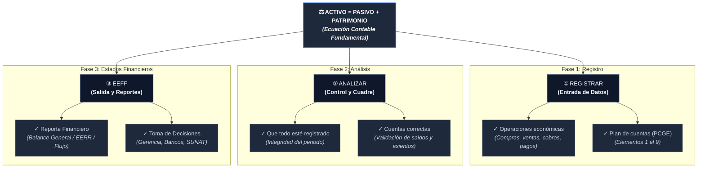

# 📊 Diagrama del Ciclo y Ecuación Contable Fundamental

Este diagrama estructura y formaliza el contenido de la pizarra explicativa, integrando la **Ecuación Contable Fundamental** con las **tres fases operativas del ciclo contable peruano (PCGE)**.

---

## 📌 1. Representación en Diagrama de Flujo (Mermaid)

---

## 🔍 2. Desglose Conceptual de la Pizarra

### ⚖️ Eje Central: Ecuación Contable Fundamental
$$\text{Activo} = \text{Pasivo} + \text{Patrimonio}$$

* **Activo:** Conjunto de recursos económicos, bienes y derechos controlados por la entidad.
* **Pasivo:** Obligaciones presentes con terceros (bancos, proveedores, tributos).
* **Patrimonio:** Participación residual de los accionistas o dueños una vez deducidos todos los pasivos.
* **Principio rector:** La **Partida Doble** (*no hay deudor sin acreedor*). Cualquier cambio en el Activo debe tener su contrapartida exacta en Pasivo o Patrimonio.

---

### ① Fase 1: REGISTRAR (Captura de Hechos Económicos)
* **Operaciones económicas:** Todo evento comercial o financiero medible en dinero (compras de mercadería, ventas de bienes/servicios, planillas de sueldos, pagos bancarios, etc.).
* **Plan Contable General Empresarial (PCGE):** Estandarización de las cuentas en Perú:
  * *Elementos 1, 2 y 3:* Cuentas del Activo.
  * *Elemento 4:* Cuentas del Pasivo.
  * *Elemento 5:* Cuentas del Patrimonio.
  * *Elemento 6 y 7:* Gastos e Ingresos por naturaleza.
  * *Elemento 8 y 9:* Cierre contable y costos.

---

### ② Fase 2: ANALIZAR (Auditoría Interna y Cuadre)
* **Todo esté registrado:** Garantizar el principio de **integridad** (que no falte ninguna factura de compras, ventas o movimientos de extractos bancarios del periodo).
* **Cuentas correctas:** Verificar que:
  * Los asientos estén correctamente imputados (evitar cargar cuentas equivocadas).
  * Las conciliaciones bancarias cuadren al céntimo.
  * Se elabore el **Balance de Comprobación** (Hoja de Trabajo) verificando la igualdad de sumas y saldos.

---

### ③ Fase 3: EEFF (Estados Financieros / Reporte Final)
* **Reporte Financiero:** Generación de los 4 estados financieros bajo NIIF:
  1. **Estado de Situación Financiera:** Reflejo directo de la fórmula $\text{Activo} = \text{Pasivo} + \text{Patrimonio}$.
  2. **Estado de Resultados:** Ganancias y pérdidas del ejercicio.
  3. **Estado de Flujos de Efectivo:** Entradas y salidas reales de liquidez.
  4. **Estado de Cambios en el Patrimonio Neto:** Variaciones en capital y reservas.
* **Propósito:** Brindar información fidedigna para la toma de decisiones estratégicas, auditorías tributarias ante SUNAT y financiamiento bancario.
